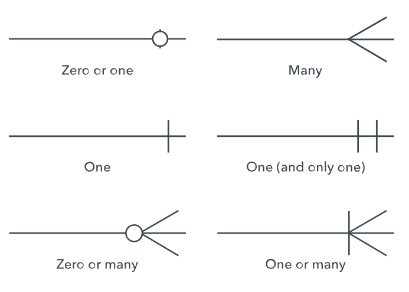

# 

**Learning objective:** By the end of this lesson, students will understand how to model relationships in MongoDB.

## MongoDB Relationships

A data entity is a representation of a real-world object or concept within an database. For example, **User**, **Post**, **Comment**, **Purchase**, etc. 

Data entities are characterized by their attributes and relationships with other data entities. 

> In MongoDB, a data entity represents a document in a MongoDB database, and corresponds with the shape of a schema. 

When working with data models in MongoDB, the primary decision revolves around how to handle relationships between data. 

## Types of relationships in MongoDB

The three types of relationships you'll encounter when working with a mongoDB database are: 

1. One-to-one (1:1)
Example: A User has a Profile, and a Profile belongs to a User

2. One-to-many (1:n)
Example: A User has many purchases, a Purchase belongs to a User

3. Many-to-many (m:n)
Example: A person has visited many places; places have been visited by many people. 

> 🧠 Within data modeling, the number of documents that a relationship can reference is known as its Cardinality. In the above examples, "to-one" vs. "to-many" are the two possible cardinalities. 

## Two approaches to forming relationships

There are two ways to model related data in MongoDB:

1. Using **embedding**, where parent documents hold sub-documents.

2. Using **referencing**, where a document contains just the related document’s `ObjectId`.

Both approaches can be used simultaneously in the same document.

## Modeling relationships in MongoDB with ERDs

An ERD (entity relationship diagram) is a flowchart that illustrates the relationship between the various data entities in a system. 

When diagramming a MongoDB database, data entities are the collections of documents that make up our database. In other words, we need to account for all of the models and schemas that we will be working with. 

When creating an ERD, we first need to identify the data entities that are involved in our data model. We would draw them as rectangles, and label them as nouns - for example: User, Profile, etc. 

[tktk ERD example with a few collections drawn out, sans relationships (should have fields)]

The next step is to determine how the entities are related. For a MongoDB database, we draw lines between associated fields to show a relationship.
For example, if Review is an embedded schema on a Post model, we would draw a line between the `Review` field of our Post model and the `_id` field on our Review model.

Not all entities will be related, which is to be expected. 

[tktk ERD example with lines drawn between collections logically (no cardinality yet)]

Finally, we need to denote the type of relationship that these lines represent. In other words, we need to show their cardinality. There are multiple ways to demonstrate this, the simplest is to just have `one` be an undecorated line, and `many` have an endpoint that is a tree or a fork.

[tktk this example, but probably don't need examples of zero]

[tktk simple ERD with all three forms of cardinality combinations]

